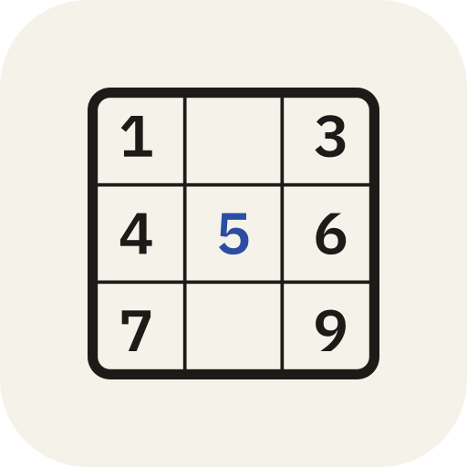

<div align="center">
  
  <h1>Hodoku Revisited</h1>
  <p><strong>The classic HoDoKu 2.2.0 Sudoku solver, generator, trainer &amp; analyzer—rebuilt in TypeScript with a symbolic AI Coach.</strong></p>

  <p>
    <a href="https://hodokurevisited.com/"><strong>Website</strong></a> ·
    <a href="https://hodokurevisited.com/play/"><strong>Open Solver</strong></a> ·
    <a href="https://hodokurevisited.com/play/?daily=1"><strong>Daily Puzzle</strong></a> ·
    <a href="https://hodokurevisited.com/play/?p=.....1.......3597.7..4...23..7.1..6....57...8.28...7..9........6.2....91.4...738.&prove=r1c9.4"><strong>Live “Why Not?” Proof Demo</strong></a> ·
    <a href="https://hodokurevisited.com/techniques/"><strong>32 Technique Guides</strong></a> ·
    <a href="https://hodokurevisited.com/manual/"><strong>Manual</strong></a>
  </p>

  <p>
    <a href="https://hodokurevisited.com/"></a>
    
    
    <a href="LICENSE"></a>
  </p>
</div>

---

## Overview

[HoDoKu](https://hodoku.sourceforge.net/) by Bernhard Hobiger (2008–2012) is widely regarded as the gold standard for human-style logical Sudoku solving and rating, but it has not had a release since 2012 and only runs as a desktop Java Swing application.

**Hodoku Revisited** ports the complete HoDoKu 2.2.0 solving, rating, and generation engine to pure TypeScript (`@hodoku/core`) and pairs it with a fast, offline-capable Progressive Web App (`@hodoku/app`), an interactive **AI Coach & Contradiction Prover**, and 32 illustrated technique guides (`@hodoku/website`). No Java and no install required—it runs in any desktop or mobile browser and installs as an offline app on iOS, Android, macOS, Windows, and Linux.

---

## Highlights

### 1. 100% Symbolic AI Super Solver & Coach (Zero API Cost, Zero Hallucinations)
Built directly on top of the solver's bitmask and chain engine in [`aiCoach.ts`](packages/app/src/aiCoach.ts):
- **4-Stage Socratic Walkthroughs (*Coach me*):** Instead of spoiling a step all at once, step through any of the 90+ techniques in four progressive stages on the board:
  1. **Where to look** — highlights the house (row, column, or box) or endpoints to scan without giving away the answer.
  2. **The pattern** — names the technique and highlights the key cells, fins, or color groups.
  3. **The logic** — explains why the pattern forces the deduction and draws strong/weak chain links on the board.
  4. **Conclusion** — reveals the final placement or struck-through candidate eliminations.
- **“Why not?” Contradiction Prover:** Select any cell on the board and click **`Why not D?`** for any candidate. The solver places that digit, propagates forced Naked and Hidden Singles, prunes the derivation tree backward from the conflict to the minimal causal chain, and draws house-aligned chain links showing the exact cell or house where a contradiction occurs.
- **1-Click Shareable Proof & Walkthrough Links:** Share a direct URL to any board state with an active contradiction proof (`?p=...&prove=r1c9.4`) or Socratic walkthrough (`?p=...&coach=1`).

### 2. Verified Step-by-Step Against HoDoKu 2.2.0
The TypeScript engine is verified in lockstep against the original `hodoku.jar` (2.2.0) in [`golden.test.ts`](packages/core/test/golden.test.ts):
- **587 puzzles / 34,672 solving steps** compared step-for-step: identical technique, identical placements and candidate eliminations, identical step order, and identical difficulty level and numerical score.
- **66,000+ "Find all steps" states** verified across all solver families (`golden-all.jsonl.gz`), plus **1,079 Kraken Fish steps** and **46,656 computed templates**.
- Covers all 13 technique families:
  - **Singles:** Full House, Naked Single, Hidden Single
  - **Intersections & Subsets:** Locked Candidates (Pointing & Claiming), Locked/Naked/Hidden Pairs, Triples, and Quads
  - **Fish:** Basic, Finned, Sashimi, Franken, Mutant, and Kraken Fish (X-Wing, Swordfish, Jellyfish, Squirmbag, Whale, Leviathan)
  - **Single-Digit Patterns:** Skyscraper, 2-String Kite, Empty Rectangle, Turbot Fish
  - **Wings:** XY-Wing, XYZ-Wing, W-Wing
  - **Uniqueness:** Unique Rectangles (Types 1–6), Hidden Rectangle, Avoidable Rectangles (Types 1–2), BUG+1
  - **Coloring:** Simple Colors (Trap & Wrap), Multi-Colors (1 & 2)
  - **Chains & Loops:** Remote Pair, X-Chain, XY-Chain, Continuous & Discontinuous Nice Loops (AIC), Grouped Nice Loops, Forcing Chains & Forcing Nets
  - **Almost Locked Sets & Misc:** ALS-XZ, ALS-XY-Wing, ALS-Chain, Death Blossom, Sue de Coq, Template Set & Delete

### 3. Trainer, Daily Puzzle & Power Tools
- **Daily Puzzle & Shareable Results:** Deterministic date-seeded daily challenge (`/play/?daily=1`) where every player worldwide gets the same board each UTC day, with a Wordle-style **Share result** summary card.
- **Playing, Learning & Practicing Modes:** Pick any set of techniques in the Training dialog; *Practicing* deals a puzzle whose solution path requires at least one of them, while *Learning* also advances the board right up to the exact step where your chosen technique applies.
- **All Steps, Solution Path & Summary:** Inspect every logical step available on the current board, step through the remaining solution path (or *Solve up to* a chosen difficulty), or view the full technique breakdown and difficulty rating.
- **Coloring, ColorKu & Digit Filter:** Paint cells and individual candidates with a 6-color palette (covered by undo/redo), play with colored balls in **ColorKu** mode, or filter the board by digit (`Alt+1..9` or long-press).
- **Extended Booklet Print & Export:** Print a single board, print with the solution grid, export a crisp `.png`, or generate multi-section puzzle books (up to 5 sections, 5 page layouts, ratings, and duplex booklet imposition).
- **Puzzle Library, History & Save Points:** Save named puzzles, browse your play history, or take named snapshots of your current board without crossing your undo history.

---

## Architecture

```text
packages/
  core/      Pure TypeScript HoDoKu 2.2.0 engine (zero DOM/Node APIs, paired 32-bit bitsets)
  app/       Installable React + Vite PWA; solver and generator run in a cancellable Web Worker
  website/   Dependency-free static site generator: 32 illustrated technique guides, learn pages & manual
```

---

## Development

Requires **Node.js 22+** and **pnpm 10+**.

```sh
pnpm install

# Typecheck all packages (core, app, website)
pnpm typecheck

# Run unit and golden tests
pnpm test
pnpm --filter @hodoku/app test
pnpm --filter @hodoku/website test

# Start the local dev server for the PWA
pnpm --filter @hodoku/app dev

# Build the production PWA and static website (output in packages/website/dist)
pnpm --filter @hodoku/app build
pnpm --filter @hodoku/website build
```

---

## Documentation

- [Port Plan & Architecture](docs/PORT-PLAN.md)
- [Feature Comparison (HoDoKu 2.2.0 vs. Hodoku Revisited)](docs/FEATURE-COMPARISON.md)
- [License Audit](docs/LICENSE-AUDIT.md)
- [Notice & Attribution](NOTICE.md)

## License

Free software under the **GNU General Public License v3.0 or later** (`GPL-3.0-or-later`), as the original HoDoKu. See [LICENSE](LICENSE) and [NOTICE.md](NOTICE.md).

Hodoku Revisited is an independent open-source port and is not affiliated with or endorsed by Bernhard Hobiger. The user interface, AI Coach, manual, and 32 technique guides are newly written for this project.
